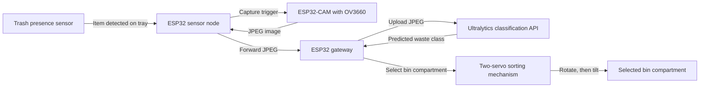

# BinGo Smart Waste Sorter

BinGo is a smart bin that photographs an item on its tray, classifies the waste, and drops it into the matching compartment using two servos. This README describes the current design draft.

## System diagram

## Sorting sequence

1. The presence sensor detects trash on the tray. The **ESP32 sensor node** tells the **ESP32-CAM** to take a picture.
2. The **ESP32-CAM**, fitted with the **OV3660**, sends one JPEG back to the sensor node. The sensor node forwards the JPEG to the **ESP32 gateway**.
3. The gateway uploads the JPEG to the **Ultralytics classification API** and maps the predicted waste class to a bin compartment.
4. **Servo 1** rotates the tray over that compartment. **Servo 2** tilts the tray to drop the item.

**Camera milestone:** Send one capture trigger from the sensor node and verify that it receives one complete, viewable JPEG from the ESP32-CAM.

## Camera UART wiring

| ESP32 sensor node | Direction | ESP32-CAM | Purpose |
| --- | --- | --- | --- |
| D26 (GPIO26, TX) | → | IO14 (RX) | Capture command |
| D27 (GPIO27, RX) | ← | IO13 (TX) | JPEG image |
| GND | ↔ | GND | Common ground |

Use the same baud rate on both boards. Start testing at `115200` baud. On an AI-Thinker ESP32-CAM, leave microSD disabled while using IO14 and IO13 for UART.

## ทดสอบกล้อง แฟลช และ Ultralytics API ใน Arduino IDE

เปิดไฟล์ `.ino` ของแต่ละบอร์ด แล้วเลือกบอร์ดและพอร์ต USB ที่ตรงกันก่อนอัปโหลด ใช้บอร์ดแพ็กเกจ **esp32 by Espressif Systems** รุ่น 3.x

| ไฟล์ | บอร์ดใน Arduino IDE |
| --- | --- |
| [BinGoCamera.ino](arduino/BinGoCamera/BinGoCamera.ino) | AI Thinker ESP32-CAM |
| [BinGoSensorNode.ino](arduino/BinGoSensorNode/BinGoSensorNode.ino) | ESP32 Dev Module |
| [BinGoGateway.ino](arduino/BinGoGateway/BinGoGateway.ino) | ESP32 Dev Module |

ใช้ผังสายกล้องด้านบน แล้วต่อ UART2 ระหว่าง sensor node กับ gateway เพิ่มตามตารางนี้

| ESP32 sensor node | ทิศทาง | ESP32 gateway |
| --- | --- | --- |
| GPIO32 (TX) | → | GPIO33 (RX) |
| GPIO33 (RX) | ← | GPIO32 (TX) |
| GND | ↔ | GND |

1. คัดลอก [Secrets.example.h](arduino/BinGoGateway/Secrets.example.h) เป็น `Secrets.h` ในโฟลเดอร์เดียวกัน ใส่ชื่อและรหัส Wi-Fi, Ultralytics API key และ HTTPS URL สำหรับโมเดล classification ที่มี weights โดยคัดลอก URL จาก **Predict → API Docs** แล้วอัปโหลด sketch ของ gateway ใหม่ Git จะข้ามไฟล์ `Secrets.h`
2. เปิด Serial Monitor หรือ serial terminal ของ **sensor node** ที่ `115200` baud ส่ง `p` แล้วดูว่ามี `PONG` ตอบกลับ
3. วางชิ้นทดสอบหน้ากล้องแล้วส่ง `c` กล้องจะเปิดแฟลชบน GPIO4 ก่อนถ่าย JPEG และปิดหลังถ่าย
4. Sensor node จะแสดง `CAM OK` แล้วตามด้วย `GATEWAY OK` รอจนเห็น `API OK HTTP 200` หรือข้อความ `API ERR` ก่อนส่ง `c` ครั้งถัดไป
5. ที่ Serial Monitor ของ **sensor node** ให้ดูคลาสที่มี confidence สูงสุดและ JSON จาก API ในบรรทัดเดียวกัน เช่น `API OK HTTP 200 | class=1 name=recycleable confidence=0.99993 | {...}` หากเห็น `API ERR HTTP 401` ให้ตรวจ API key และหากเห็น `404` ให้ตรวจ URL กับสิทธิ์เข้าถึงโมเดล

คำสั่ง `c` และน้ำหนักจำลอง `42 g` ใช้แทนการตรวจจับและค่าจาก HX711 ในรอบนี้ Gateway ตรวจขนาด, CRC32 และไบต์เริ่มต้นกับสิ้นสุดของ JPEG ก่อนส่งภาพจริงเป็นฟิลด์ `file` ผ่าน HTTPS ไปยัง Ultralytics [เอกสาร Inference API](https://docs.ultralytics.com/platform/deploy/inference)

## อัปโหลดเฟิร์มแวร์ผ่าน Wi-Fi (OTA)

แต่ละ sketch อ่านรหัสอัปโหลดจาก `OtaSecrets.h` ในโฟลเดอร์ของตัวเอง สำหรับเครื่องใหม่ให้คัดลอก [OtaSecrets.example.h](arduino/OtaSecrets.example.h) ไปยังแต่ละโฟลเดอร์โดยตั้งชื่อเป็น `OtaSecrets.h` แล้วกรอกค่าที่ใช้จริง Gateway ใช้ค่า Wi-Fi จาก `Secrets.h` ส่วน sensor node และกล้องใช้ค่า Wi-Fi จาก `OtaSecrets.h` ทั้งสามไฟล์ถูกตั้งให้ Git ข้ามไว้

| บอร์ด | พอร์ตใน Arduino IDE | Partition Scheme |
| --- | --- | --- |
| Gateway | `bingo-gateway` | ค่าเริ่มต้นของ DOIT ESP32 DEVKIT V1 |
| Sensor node | `bingo-sensor-node` | ค่าเริ่มต้นของ DOIT ESP32 DEVKIT V1 |
| ESP32-CAM | `bingo-camera` | **Minimal SPIFFS (1.9MB APP with OTA/128KB SPIFFS)** |

1. ใช้สาย USB อัปโหลดเฟิร์มแวร์ OTA ครั้งแรกให้ครบทีละบอร์ด สำหรับ ESP32-CAM ให้เลือก Partition Scheme ตามตารางก่อนอัปโหลด
2. ให้บอร์ดมีไฟเลี้ยงและให้คอมอยู่บนเครือข่ายเดียวกัน บอร์ดจะแสดง `OTA READY` พร้อมชื่อและ IP ใน Serial Monitor หลังเชื่อมต่อ Wi-Fi
3. เปิด sketch ของบอร์ดที่จะอัปเดต เลือก **Tools → Port → Network Ports** แล้วเลือกชื่อตามตาราง กด **Upload** และกรอกค่า `kOtaPassword` ของบอร์ดนั้น ใช้ Partition Scheme เดิมทุกครั้ง
4. เริ่มอัปโหลดช่วงที่ระบบว่างจากการถ่ายภาพและเรียก API เมื่ออัปโหลดสำเร็จบอร์ดจะรีสตาร์ตและแสดงพอร์ตเครือข่ายอีกครั้ง

## Gateway LCD1602 wiring

The gateway supports a 16×2 HD44780-compatible LCD with a PCF8574 I²C backpack at `0x27` or `0x3F`.

| ESP32 gateway | I²C level shifter for a 5 V LCD | LCD backpack |
| --- | --- | --- |
| GPIO21 | SDA on LV side ↔ SDA on HV side | SDA |
| GPIO22 | SCL on LV side ↔ SCL on HV side | SCL |
| GND | GND | GND |
| 3V3 | LV | |
| 5 V supply | HV | VCC |

Use a bidirectional I²C level shifter for a 5 V backpack. If the LCD and backpack are both rated for 3.3 V operation, power the module from 3V3 and connect SDA and SCL directly.

1. In Arduino IDE Library Manager, install `LiquidCrystal_I2C` by Martin Kubovčík and Frank de Brabander (version 2.0.0).
2. Upload `BinGoGateway.ino` and open the gateway Serial Monitor at `115200`. It should report `LCD READY` with the detected address. The LCD shows `Bingo` centered above `Ready`.
3. Send `c` to the sensor node. The second row shows `Classifying...` followed by the class name with the highest confidence, up to 16 characters. It shows `No prediction` if no valid class is available, or `API error` if the request fails.

If the screen is blank after `LCD READY`, adjust the contrast screw on the backpack. If the gateway reports `LCD ERR no device at 0x27 or 0x3F`, check the wiring and confirm the backpack address with an I²C scanner.

## Reference

[Ameru Smart Bin](https://www.ameru.ai/products/airport-pro-bin) uses a similar tray mechanism that rotates and tilts to sort waste.
