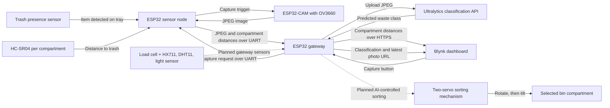

# BinGo Smart Waste Sorter

BinGo is a smart waste sorter. The prototype photographs items, classifies them with Ultralytics, and reports compartment clearance to Blynk. The sorting mechanism and three additional gateway sensors are planned for when the hardware arrives.

## System diagram



## Planned sorting sequence

1. The presence sensor detects trash on the tray. The **ESP32 sensor node** tells the **ESP32-CAM** to take a picture.
2. The **ESP32-CAM**, fitted with the **OV3660**, sends one JPEG back to the sensor node. The sensor node forwards the JPEG to the **ESP32 gateway**.
3. The gateway uploads the JPEG to the **Ultralytics classification API** and maps the predicted waste class to a bin compartment.
4. **Servo 1** rotates the tray over that compartment. **Servo 2** tilts the tray to drop the item.

**Camera milestone:** Send one capture trigger from the sensor node and verify that it receives one complete, viewable JPEG from the ESP32-CAM.

The prototype can trigger the camera from Blynk or with the serial command `c`. The AI classification appears on the gateway LCD and on the configured Blynk dashboard. Once the hardware arrives, the gateway will use the predicted class to select a compartment and then command the two servos. The mechanism will need a safe stop, such as a timeout or a manual stop, for testing and demonstration.

## Sensor allocation

| Board | Sensor types | Status |
| --- | --- | --- |
| Sensor node | OV3660 camera via the ESP32-CAM, HC-SR04 ultrasonic distance | 2 types in use |
| Gateway | Load cell with HX711, DHT11, light sensor | 3 types planned |

The two HC-SR04 modules count as one sensor type. The planned configuration has five distinct types once the gateway reads and uses all three new sensors.

## Reserved gateway pins for servos

| Servo | Signal pin on the gateway ESP32 | Function |
| --- | --- | --- |
| Servo 1 | GPIO25 | Rotate the tray toward the selected compartment |
| Servo 2 | GPIO26 | Tilt the tray to drop the item |

GPIO25 and GPIO26 can output PWM and are available alongside the current UART and LCD pins. These assignments are for the gateway board. [ESP32 GPIO reference](https://docs.espressif.com/projects/esp-idf/en/latest/esp32/api-reference/peripherals/gpio.html)

Connect each servo's signal wire to its assigned GPIO. Use a separate regulated supply rated for the servo voltage and the combined current of both motors. Connect the servo grounds, supply ground, and gateway GND together. Check the servo's pinout and 3.3 V signal compatibility before wiring. Firmware control is planned.

## Camera UART wiring

| ESP32 sensor node | Direction | ESP32-CAM | Purpose |
| --- | --- | --- | --- |
| D26 (GPIO26, TX) | → | IO14 (RX) | Capture command |
| D27 (GPIO27, RX) | ← | IO13 (TX) | JPEG image |
| GND | ↔ | GND | Common ground |

Use the same baud rate on both boards. Start testing at `115200` baud. On an AI-Thinker ESP32-CAM, leave microSD disabled while using IO14 and IO13 for UART.

## Compartment room sensors (HC-SR04)

Mount one HC-SR04 above each trash compartment, pointing down with a clear path to the bottom. The two enabled sensors are numbered by physical compartment: connect bin 1 to the first GPIO pair and bin 2 to the second. For three or four compartments, wire the additional sensors and change `kBinCount` in `BinGoSensorNode.ino` to match.

| Compartment | TRIG on sensor node | ECHO on sensor node (through divider) |
| --- | --- | --- |
| 1 | GPIO18 | GPIO34 |
| 2 | GPIO19 | GPIO35 |
| 3 (optional) | GPIO21 | GPIO36 (VP) |
| 4 (optional) | GPIO22 | GPIO39 (VN) |

Power each standard HC-SR04 from **5 V** and connect its GND to the sensor node's GND. Wire TRIG directly. Each 5 V ECHO output needs its **own voltage divider** before reaching the ESP32: connect HC-SR04 ECHO to one end of a **2.2 kΩ** resistor, connect the other end to the ESP32 ECHO GPIO, and connect a **3.3 kΩ** resistor from that GPIO to GND. The GPIO receives about 3 V when ECHO is high. See the [HC-SR04 datasheet](https://cdn.sparkfun.com/datasheets/Sensors/Proximity/HCSR04.pdf) and [ESP32 datasheet](https://documentation.espressif.com/esp32_datasheet_en.html).

1. Upload `BinGoSensorNode.ino`. Open the **sensor node** Serial Monitor at `115200` baud and send `f`. Each enabled sensor reports its clearance in cm. The node pings one sensor at a time to reduce interference.
2. With the compartments empty, copy each stable clearance into the corresponding `emptyCm` field in `kBins` (the third value in each row). Set `fullCm` (the fourth value) to the distance from the sensor to the highest acceptable trash level; the starting value is 5 cm. Keep `2 ≤ fullCm < emptyCm ≤ 400`.
3. Upload again and send `f`. An empty bin should read close to `100% room left`. Hold a flat target at the full line to check for close to `0%`, and try a point between the two. Unplug an ECHO lead on the sensor side of the divider to verify that the node reports `room unknown` for that bin while still reporting the other bins.

Room left is an estimate of remaining **height** between the calibrated empty and full positions; uneven trash can change the reading. If the surface is too close or doesn't return a usable echo, the node reports an unknown reading. The sensor node prints readings to Serial Monitor and sends the distances to the gateway. The gateway LCD displays classification results.

## Blynk dashboard

1. In the **BinGo** template in Blynk.Console, use **Virtual Pin** datastreams **V0** for compartment 1 and **V1** for compartment 2. Check that both use type **Double**, unit **cm**, and range **2–400**. Add a value widget for each datastream to the Web Dashboard. Enable **Save RAW Data** in the datastream settings to retain individual readings. If compartments 3 and 4 are enabled on the sensor node, set up **V2** and **V3** for them.
2. On the gateway, copy [BlynkSecrets.example.h](arduino/BinGoGateway/BlynkSecrets.example.h) to `BlynkSecrets.h`, set `BLYNK_AUTH_TOKEN` to the BinGo device's token, and check that `BLYNK_SERVER` matches the region shown in Blynk.Console. The gateway connects through its existing Wi-Fi settings in `Secrets.h`. Readings use the Blynk HTTPS API. Install the Blynk Arduino library if you enable dashboard capture.
3. Upload the gateway sketch first, then the sensor node sketch. The node sends the measured clearance in cm over UART every 30 seconds. To trigger a reading immediately, enter `f` in the sensor node's Serial Monitor. Look for `BLYNK OK HTTP 200` in the gateway's Serial Monitor, then move a target beneath a sensor and confirm that the corresponding dashboard value changes. Distances work before fill percentage calibration. A missed echo leaves that compartment's last valid value in Blynk.
4. For the BH1750 on the gateway, set up **Ambient Light** as a Virtual Pin datastream on **V4** with type **Double**, unit **lux**, and range **0–55000**. Bind the dashboard widget to V4. The gateway sends a valid light reading about every 30 seconds and logs `BLYNK V4 OK HTTP 200` after a successful upload.

**If Blynk shows Offline in a readings-only setup:** The gateway sends each batch in a short HTTPS request and closes the connection after the upload. To make the status reflect recent readings, open **Blynk.Console → Developer Zone → My Templates → BinGo → Connection Lifecycle** and enable **Log when device reports any data**. Set the **Wait Period** to **90 seconds** to allow for delayed readings. Blynk shows the device as Online when it receives data and marks it Offline if no new data arrives within the wait period. [Blynk Connection Lifecycle](https://docs.blynk.io/en/blynk.console/templates/connection-lifecycle)

### Capture and classify from Blynk Free

In the **BinGo** template, add these Virtual Pin datastreams and bind them to widgets on the device dashboard.

| Pin | Datastream | Dashboard widget |
| --- | --- | --- |
| V5 | **Capture Photo**, Integer, 0–1, default 0 | **Image Button** in **Push** mode on the web, or **Button** in **Push** mode in the mobile app |
| V6 | **Latest Classification**, String | **Label** (Web Dashboard) or **Labeled Value** (mobile app) |
| V7 | **Latest Photo**, Integer, 0–1, default 0 | **Image Gallery**, with the photo URL in the first slot |

Leave **Sync with latest server value** off on V5 so the device starts with a released button. Enable it on V6 to keep the latest result visible across reconnects. Save and apply the template, then open the BinGo device's live dashboard.

1. Install **Blynk** from Arduino IDE's Library Manager. Add `BLYNK_TEMPLATE_ID` and `BLYNK_TEMPLATE_NAME` from Blynk.Console to the gateway's existing `BlynkSecrets.h`. The gateway uses its existing token and joins Wi-Fi as before.
2. To enable the photo, set `BLYNK_PHOTO_URL` to the full HTTPS URL for `/latest.jpg`, with no query string. Configure an HTTPS reverse proxy from this URL to `http://<gateway-IP>/latest.jpg` and enter the same HTTPS URL in the Image Gallery. Your dashboard must be able to load the URL.
3. Upload the gateway and sensor node sketches. Put an item in front of the camera and tap **Capture Photo** once. The gateway requests the same capture as `c`, classifies the JPEG through Ultralytics, and updates the photo and the class with its confidence. Tap again after the result to test a new item.

The gateway serves the JPEG directly from its existing RAM buffer and sends Blynk a new URL revision to refresh the widget. Each valid capture replaces the previous frame. Restarting the gateway clears the photo. The gateway returns HTTP 404 before the first valid capture or if a JPEG transfer overwrites the buffer and fails validation. The capture button and classification label can also be used with `BLYNK_PHOTO_URL` omitted. [Blynk Image Gallery](https://docs.blynk.io/en/blynk.apps/widgets-displays/image-gallery)

For a local Web Dashboard test, you can run an HTTPS proxy on the computer that opens Blynk. With Caddy installed and its local CA trusted by that computer, replace `192.168.1.50` with the gateway's LAN IP.

```sh
caddy reverse-proxy --from https://localhost:8443 --to http://192.168.1.50 --internal-certs --disable-redirects
```

Use `https://localhost:8443/latest.jpg` for `BLYNK_PHOTO_URL` and V7. Leave the proxy running and open the Web Dashboard on that same computer. After a capture, open the HTTPS photo URL directly to check that it loads with a trusted certificate. A dashboard viewed on a different device needs an HTTPS URL reachable from that device. [Caddy local HTTPS](https://caddyserver.com/docs/automatic-https#local-https)

## ทดสอบกล้อง แฟลช และ Ultralytics API ใน Arduino IDE

เปิดไฟล์ `.ino` ของแต่ละบอร์ด แล้วเลือกบอร์ดและพอร์ต USB ที่ตรงกันก่อนอัปโหลด ใช้บอร์ดแพ็กเกจ **esp32 by Espressif Systems** รุ่น 3.x

| ไฟล์ | บอร์ดใน Arduino IDE |
| --- | --- |
| [BinGoCamera.ino](arduino/BinGoCamera/BinGoCamera.ino) | AI Thinker ESP32-CAM |
| [BinGoSensorNode.ino](arduino/BinGoSensorNode/BinGoSensorNode.ino) | ESP32 Dev Module |
| [BinGoGateway.ino](arduino/BinGoGateway/BinGoGateway.ino) | ESP32 Dev Module |

ใช้ผังสายกล้องด้านบน แล้วต่อ UART2 ระหว่าง sensor node กับ gateway เพิ่มตามตารางนี้

| ESP32 sensor node | ทิศทาง | ESP32 gateway |
| --- | --- | --- |
| GPIO32 (TX) | → | GPIO33 (RX) |
| GPIO33 (RX) | ← | GPIO32 (TX) |
| GND | ↔ | GND |

1. คัดลอก [Secrets.example.h](arduino/BinGoGateway/Secrets.example.h) เป็น `Secrets.h` ในโฟลเดอร์เดียวกัน ใส่ชื่อและรหัส Wi-Fi, Ultralytics API key และ HTTPS URL สำหรับโมเดล classification ที่มี weights โดยคัดลอก URL จาก **Predict → API Docs** แล้วอัปโหลด sketch ของ gateway ใหม่ Git จะข้ามไฟล์ `Secrets.h`
2. เปิด Serial Monitor หรือ serial terminal ของ **sensor node** ที่ `115200` baud ส่ง `p` แล้วดูว่ามี `PONG` ตอบกลับ
3. วางชิ้นทดสอบหน้ากล้องแล้วส่ง `c` กล้องจะเปิดแฟลชบน GPIO4 ก่อนถ่าย JPEG และปิดหลังถ่าย
4. Sensor node จะแสดง `CAM OK` แล้วตามด้วย `GATEWAY OK` รอจนเห็น `API OK HTTP 200` หรือข้อความ `API ERR` ก่อนส่ง `c` ครั้งถัดไป
5. ที่ Serial Monitor ของ **sensor node** ให้ดูคลาสที่มี confidence สูงสุดและ JSON จาก API ในบรรทัดเดียวกัน เช่น `API OK HTTP 200 | class=1 name=recycleable confidence=0.99993 | {...}` หากเห็น `API ERR HTTP 401` ให้ตรวจ API key และหากเห็น `404` ให้ตรวจ URL กับสิทธิ์เข้าถึงโมเดล

คำสั่ง `c` และน้ำหนักจำลอง `42 g` ใช้แทนการตรวจจับและค่าจาก HX711 ในรอบนี้ Gateway ตรวจขนาด, CRC32 และไบต์เริ่มต้นกับสิ้นสุดของ JPEG ก่อนส่งภาพจริงเป็นฟิลด์ `file` ผ่าน HTTPS ไปยัง Ultralytics [เอกสาร Inference API](https://docs.ultralytics.com/platform/deploy/inference)

## อัปโหลดเฟิร์มแวร์ผ่าน Wi-Fi (OTA)

แต่ละ sketch อ่านรหัสอัปโหลดจาก `OtaSecrets.h` ในโฟลเดอร์ของตัวเอง สำหรับเครื่องใหม่ให้คัดลอก [OtaSecrets.example.h](arduino/OtaSecrets.example.h) ไปยังแต่ละโฟลเดอร์โดยตั้งชื่อเป็น `OtaSecrets.h` แล้วกรอกค่าที่ใช้จริง Gateway ใช้ค่า Wi-Fi จาก `Secrets.h` ส่วน sensor node และกล้องใช้ค่า Wi-Fi จาก `OtaSecrets.h` ทั้งสามไฟล์ถูกตั้งให้ Git ข้ามไว้

| บอร์ด | พอร์ตใน Arduino IDE | Partition Scheme |
| --- | --- | --- |
| Gateway | `bingo-gateway` | ค่าเริ่มต้นของ DOIT ESP32 DEVKIT V1 |
| Sensor node | `bingo-sensor-node` | ค่าเริ่มต้นของ DOIT ESP32 DEVKIT V1 |
| ESP32-CAM | `bingo-camera` | **Minimal SPIFFS (1.9MB APP with OTA/128KB SPIFFS)** |

1. ใช้สาย USB อัปโหลดเฟิร์มแวร์ OTA ครั้งแรกให้ครบทีละบอร์ด สำหรับ ESP32-CAM ให้เลือก Partition Scheme ตามตารางก่อนอัปโหลด
2. ให้บอร์ดมีไฟเลี้ยงและให้คอมอยู่บนเครือข่ายเดียวกัน บอร์ดจะแสดง `OTA READY` พร้อมชื่อและ IP ใน Serial Monitor หลังเชื่อมต่อ Wi-Fi
3. เปิด sketch ของบอร์ดที่จะอัปเดต เลือก **Tools → Port → Network Ports** แล้วเลือกชื่อตามตาราง กด **Upload** และกรอกค่า `kOtaPassword` ของบอร์ดนั้น ใช้ Partition Scheme เดิมทุกครั้ง
4. เริ่มอัปโหลดช่วงที่ระบบว่างจากการถ่ายภาพและเรียก API เมื่ออัปโหลดสำเร็จบอร์ดจะรีสตาร์ตและแสดงพอร์ตเครือข่ายอีกครั้ง

## ทดสอบมุมถาดด้วย MPU-6050

ยึดโมดูลกับถาดโดยให้หน้าบอร์ดหงายขึ้นตอนถาดราบ ต่อ `SDA → GPIO23`, `SCL → GPIO27`, `GND → GND` และใช้ `3V3` กับ `VCC` หากโมดูลรองรับไฟเลี้ยง 3.3 V สาย SDA และ SCL ต้องมี pull-up ไปที่ 3.3 V ถ้าโมดูลมี pull-up บนบอร์ดอยู่แล้ว ใช้ของบนโมดูลได้

1. ตั้ง `kMpuDiagnosticMode = true` ใน `BinGoGateway.ino` แล้วอัปโหลดไปยัง ESP32 Gateway ผ่าน USB โหมดนี้พัก LCD, BH1750, UART ไปยัง sensor node, Blynk และ OTA
2. ปิด Arduino Serial Monitor แล้วเปิด macOS Terminal ใช้ `ls /dev/cu.*` หา USB port ของ Gateway และเปิดด้วย `screen /dev/cu.usbserial-0001 115200` โดยเปลี่ยนชื่อพอร์ตให้ตรงกับบอร์ด
3. วางถาดราบและนิ่งตอนเปิดบอร์ดหรือกด `EN` เพื่อวัดค่าไจโรขณะหยุดนิ่ง หน้าจอจะอัปเดตรูปด้านหน้า ด้านข้าง และด้านบนประมาณ 10 ครั้งต่อวินาที กด `Z` ตอนถาดราบเพื่อตั้งมุมหมุนเป็นศูนย์ มุมหมุนเป็นค่าจากจุดอ้างอิงและจะสะสมความคลาดเคลื่อน หากเอียงเกิน 15° ให้กลับมาราบแล้วกด `Z` อีกครั้ง
4. ออกจาก `screen` ด้วย `Ctrl+A` แล้วกด `k` ตามด้วย `y` เมื่อต้องการกลับไปใช้ Gateway ปกติ ให้ตั้ง `kMpuDiagnosticMode = false` และอัปโหลดผ่าน USB อีกครั้ง

## Gateway LCD1602 wiring

The gateway supports a 16×2 HD44780-compatible LCD with a PCF8574 I²C backpack at `0x27` or `0x3F`.

| ESP32 gateway | I²C level shifter for a 5 V LCD | LCD backpack |
| --- | --- | --- |
| GPIO21 | SDA on LV side ↔ SDA on HV side | SDA |
| GPIO22 | SCL on LV side ↔ SCL on HV side | SCL |
| GND | GND | GND |
| 3V3 | LV | |
| 5 V supply | HV | VCC |

Use a bidirectional I²C level shifter for a 5 V backpack. If the LCD and backpack are both rated for 3.3 V operation, power the module from 3V3 and connect SDA and SCL directly.

1. In Arduino IDE Library Manager, install `LiquidCrystal_I2C` by Martin Kubovčík and Frank de Brabander (version 2.0.0).
2. Upload `BinGoGateway.ino` and open the gateway Serial Monitor at `115200`. It should report `LCD READY` with the detected address. The LCD shows `Bingo` centered above `Ready`.
3. Send `c` to the sensor node. The second row shows `Classifying...` followed by the class name with the highest confidence, up to 16 characters. It shows `No prediction` if no valid class is available, or `API error` if the request fails. After five seconds, the display returns to `Ready`.

If the screen is blank after `LCD READY`, adjust the contrast screw on the backpack. If the gateway reports `LCD ERR no device at 0x27 or 0x3F`, check the wiring and confirm the backpack address with an I²C scanner.

## Reference

[Ameru Smart Bin](https://www.ameru.ai/products/airport-pro-bin) uses a similar tray mechanism that rotates and tilts to sort waste.
